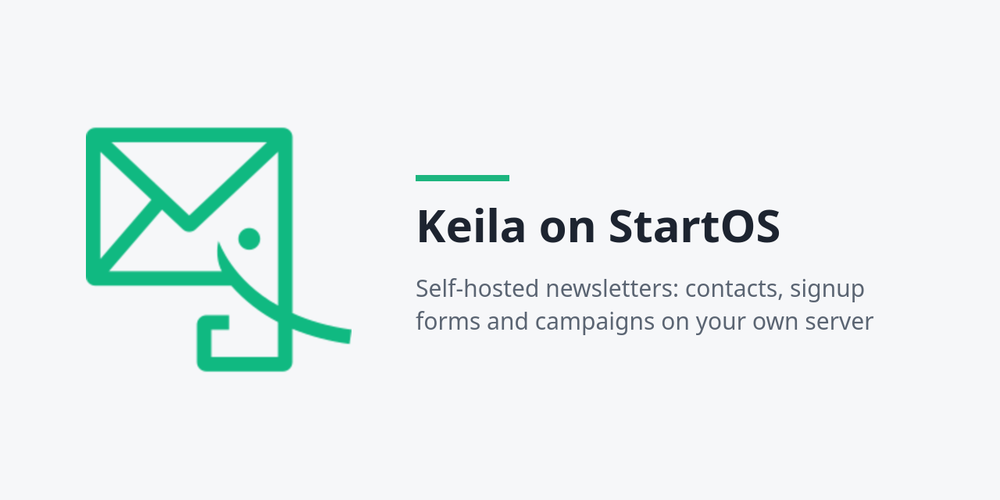

<p align="center">
  
</p>

# Keila on StartOS

> Everything not listed in this document should behave the same as upstream
> Keila. If a feature, setting, or behavior is not mentioned here, the
> upstream documentation is accurate and fully applicable — see the
> Documentation section of `instructions.md` for links.

[Keila](https://github.com/pentacent/keila) is an open-source newsletter tool: contacts, segments, signup forms, and campaigns sent through SMTP, Amazon SES, Mailgun, Postmark or Sendgrid. This package runs it with a bundled PostgreSQL, manages the admin credential and system mailer from StartOS, and adds contact import and export through NextExplorer, FileBrowser Quantum or Nextcloud.

Upstream also sells a hosted service, Keila Cloud, with no free plan and plans priced by monthly email volume. The self-hosted instance differs from it in four ways:

- **No plan caps the number of emails.** Sending is limited only by the mail provider configured in Keila and that provider's own pricing. Keila Cloud also accepts your own mail server, but every plan still has a monthly email allowance.
- **Subscriber data stays on the server.** Contacts, segments, signup forms and campaigns live in the bundled PostgreSQL on this server, not with a third party.
- **The newsletter is backed up with the server.** The database, settings and campaign images are included in StartOS backups and restore with nothing to redo.
- **Contact lists move through the server's own file services.** Import and export read and write CSV files in NextExplorer, FileBrowser Quantum or Nextcloud on the same server.

---

## Table of Contents

- [Image and Container Runtime](#image-and-container-runtime)
- [Volume and Data Layout](#volume-and-data-layout)
- [File Models](#file-models)
- [Dependencies](#dependencies)
- [Network Access and Interfaces](#network-access-and-interfaces)
- [Installation and First-Run Flow](#installation-and-first-run-flow)
- [Actions](#actions)
- [Tasks](#tasks)
- [Health Checks](#health-checks)
- [Backups and Restore](#backups-and-restore)
- [Limitations and Differences](#limitations-and-differences)
- [Quick Reference for AI Consumers](#quick-reference-for-ai-consumers)

---

## Image and Container Runtime

Keila is built from source; PostgreSQL is the official image.

| Image      | Source                                                                                                                                                                                                                                                | Architectures   |
| ---------- | ----------------------------------------------------------------------------------------------------------------------------------------------------------------------------------------------------------------------------------------------------- | --------------- |
| `keila`    | Custom `Dockerfile` building the `keila/` git submodule the way upstream's `ops/Dockerfile` does. Upstream publishes `pentacent/keila` for amd64 only. One carried patch, listed in [patches/README.md](patches/README.md), is applied at build time. | x86_64, aarch64 |
| `postgres` | `postgres` (Alpine variant), unmodified                                                                                                                                                                                                               | x86_64, aarch64 |

Subcontainers:

- `postgres-sub` — PostgreSQL, listening on `127.0.0.1:5432` only.
- `keila-sub` — runs the `apply-admin-password` oneshot, then the Keila release (`/opt/app/bin/keila start`, the image's default entrypoint) on port 4000.

Actions that touch the database (`import-contacts`, `export-contacts`) start a short-lived Keila container of their own and run `bin/keila eval` against the running PostgreSQL.

The carried patch adds a `CHECK_ORIGIN` environment variable. Upstream accepts the admin UI's LiveView WebSocket only from the `URL_HOST` origin, so on any other address of the service (`.local`, LAN IP, onion) the live pages would refuse to connect. The package sets `CHECK_ORIGIN` to every hostname of the Web UI interface.

## Volume and Data Layout

Three volumes; the database is never visible to the other two.

| Volume    | Mount point                             | Contents                                                                 |
| --------- | --------------------------------------- | ------------------------------------------------------------------------ |
| `startos` | (not mounted in the service)            | `store.json`: package settings and internal secrets                      |
| `uploads` | `/opt/app/uploads` in `keila-sub`       | Images and files uploaded in Keila (`USER_CONTENT_DIR`), served by Keila |
| `db`      | `/var/lib/postgresql` in `postgres-sub` | PostgreSQL data (`PGDATA` is `/var/lib/postgresql/data`)                 |

The package's Elixir scripts (`assets/admin.exs`, `assets/contacts.exs`) are mounted read-only at `/opt/startos` in every Keila container.

## File Models

Keila is configured entirely through environment variables, built on every start from `store.json`; nothing is written into Keila's own files.

`store.json` (on the `startos` volume) holds:

- `postgresPassword`, `secretKeyBase` — generated once at install. `secretKeyBase` is Keila's `SECRET_KEY_BASE`: it signs sessions and every unsubscribe, opt-in and tracking link already sent, and derives the project id salt. Changing it breaks links in emails already delivered.
- `adminEmail` (`admin@keila.local`) and `adminPassword` — the root account's credentials, written by **Set Admin Password**.
- `url` — the address chosen with **Set Public Address**.
- `registrationEnabled`, `smtp`, `captcha`, `fileStorage` — written by their actions.

Environment the package sets on Keila, re-asserted on every start (a change takes effect only through the actions, which rewrite `store.json` and so restart the service):

| Variable                                                     | Source                                                                                                                                                                                                        |
| ------------------------------------------------------------ | ------------------------------------------------------------------------------------------------------------------------------------------------------------------------------------------------------------- |
| `DB_URL`, `SECRET_KEY_BASE`                                  | `store.json` secrets                                                                                                                                                                                          |
| `URL_HOST`, `URL_SCHEMA`, `URL_PORT`                         | the chosen public address                                                                                                                                                                                     |
| `CHECK_ORIGIN`                                               | every non-local hostname of the Web UI interface; re-read when addresses change                                                                                                                               |
| `MAILER_SMTP_*`                                              | the system-email selection. With email disabled (or System Credentials chosen while StartOS has no SMTP configured) a placeholder mailer is set: Keila refuses to start without one, and its emails then fail |
| `KEILA_USER`, `KEILA_PASSWORD`                               | `adminEmail`, `adminPassword`. Keila reads these only on the start that finds the database empty                                                                                                              |
| `DISABLE_REGISTRATION`                                       | inverse of `registrationEnabled`                                                                                                                                                                              |
| `CAPTCHA_PROVIDER`, `CAPTCHA_SITE_KEY`, `CAPTCHA_SECRET_KEY` | only when keys are saved; otherwise Keila falls back to hCaptcha's public test keys                                                                                                                           |
| `USER_CONTENT_DIR`                                           | `/opt/app/uploads`                                                                                                                                                                                            |
| `DISABLE_UPDATE_CHECKS`                                      | `true` — StartOS delivers updates                                                                                                                                                                             |

Because `KEILA_PASSWORD` is read only on the first start, a password rotated later reaches Keila through the `apply-admin-password` oneshot instead (see [Actions](#actions)).

## Dependencies

All three dependencies are optional, and at most one is active: the one chosen in **File Storage**. Each is declared `exists` — Keila never talks to the running service. It mounts the `Keila` folder read-write only inside the temporary container of the File Storage, Import Contacts and Export Contacts actions, and read-only for the File Storage health check.

| Dependency          | When required                        | What is mounted (read-write, at `/mnt/files`)                                                                                                                                                                                         |
| ------------------- | ------------------------------------ | ------------------------------------------------------------------------------------------------------------------------------------------------------------------------------------------------------------------------------------- |
| NextExplorer        | `fileStorage.service = nextexplorer` | `data` volume, subpath `Keila`. Keila first runs NextExplorer's `add-location` action (dependent access) with the name `Keila`, which creates `/mnt/Keila` owned by uid 1000, or succeeds if it already exists                        |
| FileBrowser Quantum | `fileStorage.service = filebrowser`  | `data` volume, subpath `Keila` (created by File Storage or the first import/export, chowned to uid 1000)                                                                                                                              |
| Nextcloud           | `fileStorage.service = nextcloud`    | `nextcloud` volume, subpath `data/<user>/files/Keila`. The user's `data/<user>/files` is checked with a read-only mount first, so a wrong username fails instead of creating a stray folder. Files are chowned to uid 33 (`www-data`) |

Exported files are chowned to the owning uid shown above and mode 644. Nothing outside the `Keila` folder is mounted.

## Network Access and Interfaces

One interface serves both the admin app and everything subscribers open.

| Interface id | Type | Port | Protocol | Purpose                                                                                                 |
| ------------ | ---- | ---- | -------- | ------------------------------------------------------------------------------------------------------- |
| `ui`         | ui   | 4000 | HTTP     | Keila admin UI, plus public forms, unsubscribe and opt-in pages, tracking redirects and uploaded images |

Every link Keila generates (emails, form embeds, image URLs) uses the address chosen with **Set Public Address**, which is also the address StartOS opens from **Open UI**. Subscribers can use only a public (clearnet) domain. Keila also makes outbound connections to the configured mail providers, to `data.iana.org` for time-zone data, and to the captcha provider when keys are set.

## Installation and First-Run Flow

Install generates the database password and `SECRET_KEY_BASE`; nothing else runs until the user answers two critical tasks.

1. **Set Admin Password** (critical task) — generates the admin password for `admin@keila.local`.
2. **Set Public Address** (critical task) — the service refuses to start without a chosen address.
3. First start: PostgreSQL initializes, the `apply-admin-password` oneshot finds no `users` table and does nothing, then Keila migrates the database and creates the root account from `KEILA_USER`/`KEILA_PASSWORD`. This takes a few minutes; the Web Interface health check has a 3-minute grace period.

Upstream's flow of reading a random root password from the logs is not used. Public registration starts **disabled**, so there is no window in which a visitor can claim the instance.

## Actions

Actions that change settings write `store.json`, which restarts Keila if it is running (seconds). Grouping in the UI: **Settings** and **Contacts**.

- **Set Admin Password** (`set-admin-password`) — run for first setup or a lost password. Writes a new `adminPassword`; on the next start the `apply-admin-password` oneshot runs `assets/admin.exs`, which checks the stored password against the root account (the oldest user) and, only if it no longer signs in, sets it with `Keila.Auth.update_user_password` — that call also signs the account out of its other sessions. Safe to repeat; each run replaces the password. Output: email and password. If the user changed the account email inside Keila, the email shown is stale but the password applies to the root account regardless.
- **Set Public Address** (`set-primary-url`) — run after adding a public domain. Changes `URL_HOST`/`URL_SCHEMA`/`URL_PORT`. Links in emails already sent keep the old address.
- **Configure System Email** (`manage-smtp`) — Keila's own emails only (password reset, account activation). Campaign delivery uses senders configured inside Keila per project and is unaffected. A `Name <addr>` from-address is reduced to the bare address Keila requires.
- **Enable/Disable Public Signups** (`toggle-registration`) — flips `DISABLE_REGISTRATION`. The admin can create accounts at `/admin/users` without it.
- **Configure Captcha** (`captcha`) — sets or clears captcha keys.
- **File Storage** (`file-storage`) — chooses the dependency above; changes which optional dependency is active. If the chosen service is installed, it then creates the `Keila` folder (for NextExplorer, through its `add-location` action) and sets its owner, the same preparation an import or export does; otherwise it only saves the choice, and running it again after installing creates the folder. Output: where the folder is.
- **Import Contacts** (`import-contacts`) — requires the service running (it uses the live database). Runs `Keila.Contacts.import_csv` in a temporary container on `<Keila folder>/<file>`, in one transaction: a bad row (for example a missing email) imports nothing and returns Keila's error message with the line number. `replace` updates existing contacts' names; `ignore` leaves them. Re-running with `ignore` is a no-op. Takes seconds for thousands of rows. Output: new-contact count and project total.
- **Export Contacts** (`export-contacts`) — requires the service running. Writes `contacts-<project-slug>-<UTC timestamp>.csv` with the columns of Keila's own export (Email, First name, Last name, Data, Status, External ID); never overwrites. Nextcloud does not list a file written this way until its **Scan Files** action runs; NextExplorer and FileBrowser Quantum show it immediately.

Import and export pick the project by name (case-insensitive) or id; blank works only when exactly one project exists. Errors name the projects that do exist.

## Tasks

Two tasks, both critical, both on Keila's own page.

| Task                          | Raised when                                                                                                     | Clears when                                                                    |
| ----------------------------- | --------------------------------------------------------------------------------------------------------------- | ------------------------------------------------------------------------------ |
| Set Admin Password (critical) | `store.json` has no `adminPassword` (fresh install)                                                             | The action runs. Does not return                                               |
| Set Public Address (critical) | No address chosen, or the chosen hostname is no longer one of the Web UI interface's addresses (domain removed) | An address of the interface is chosen. Returns if that domain is later removed |

## Health Checks

Two checks follow the daemons' readiness; three more report configuration.

| Check          | Probes                                                                                                                                                                  | Failure means                                                                                                                                                                                                                                          |
| -------------- | ----------------------------------------------------------------------------------------------------------------------------------------------------------------------- | ------------------------------------------------------------------------------------------------------------------------------------------------------------------------------------------------------------------------------------------------------ |
| Database       | `pg_isready` on 127.0.0.1                                                                                                                                               | PostgreSQL is starting or crashed; check `postgres-sub` logs                                                                                                                                                                                           |
| Web Interface  | `GET /auth/login` on port 4000 (3-minute grace period)                                                                                                                  | During first start: migrations still running. Later: Keila crash-looping — the log usually names a missing or invalid `MAILER_SMTP_*`, database, or `SECRET_KEY_BASE` setting                                                                          |
| Public Address | whether the chosen address is a public domain of the interface                                                                                                          | Failure is a configuration warning, not a fault: emails are going out with links subscribers cannot open. Fix by adding a public domain and choosing it with Set Public Address                                                                        |
| System Email   | whether a mailer is configured                                                                                                                                          | Reports `disabled` when no SMTP is set; password resets and account emails fail. Campaigns are unaffected                                                                                                                                              |
| File Storage   | at start and every 5 minutes: the chosen service is installed, and a read-only mount of its `Keila` folder succeeds, is a directory, and is owned by that service's uid | Reports `disabled` when no service is chosen. Failure names the cause: service not installed, Nextcloud username wrong, folder missing (removed in the file service), a file in its place, or wrong owner. Rerunning File Storage fixes the last three |

## Backups and Restore

The database is dumped, not copied; `startos` and `uploads` are copied as files.

- **Strategy:** `withPgDump` — `pg_dump` of the `keila` database at backup time, replayed with `pg_restore` into a fresh cluster on restore (portable across CPU architectures). `startos` (settings and secrets) and `uploads` (campaign images) are copied wholesale.
- **Excluded:** nothing the service needs. Files in the `Keila` folder of the file service belong to that service and are backed up with it.
- **After restore:** nothing to redo. Secrets, admin password, public address and settings return as they were. If the restored server's interface lacks the old public domain, the Set Public Address task appears.

## Limitations and Differences

1. Built from source rather than upstream's image, which has no arm64 build; behaviour is upstream's plus the `CHECK_ORIGIN` patch.
2. Only one admin account is managed by StartOS (the first account Keila created). Other accounts are managed inside Keila.
3. System email cannot be fully disabled in Keila; "Disabled" sets a placeholder mailer, so emails Keila tries to send for accounts fail (logged), while the service runs normally.
4. Without captcha keys, Keila uses hCaptcha's public test keys, which load hCaptcha's script but block nothing.
5. The file-service integration exchanges contact CSV files only. Campaign images stay on the `uploads` volume and are served by Keila.

---

## Quick Reference for AI Consumers

```yaml
package_id: keila
image: keila (built from the keila/ submodule), postgres
architectures: [x86_64, aarch64]
subcontainers: [postgres-sub, keila-sub]
volumes:
  startos: (store.json, not mounted in the service)
  uploads: /opt/app/uploads
  db: /var/lib/postgresql
file_models:
  - store.json
startos_managed_env_vars:
  - DB_URL
  - SECRET_KEY_BASE
  - URL_HOST
  - URL_SCHEMA
  - URL_PORT
  - CHECK_ORIGIN
  - MAILER_SMTP_HOST
  - MAILER_SMTP_PORT
  - MAILER_SMTP_FROM_EMAIL
  - MAILER_SMTP_USER
  - MAILER_SMTP_PASSWORD
  - MAILER_SMTP_AUTH_METHOD
  - MAILER_SMTP_TLS_MODE
  - KEILA_USER
  - KEILA_PASSWORD
  - DISABLE_REGISTRATION
  - CAPTCHA_PROVIDER
  - CAPTCHA_SITE_KEY
  - CAPTCHA_SECRET_KEY
  - USER_CONTENT_DIR
  - DISABLE_UPDATE_CHECKS
dependencies:
  [nextexplorer (optional), filebrowser (optional), nextcloud (optional)]
interfaces:
  ui: { type: ui, port: 4000 }
actions:
  - set-admin-password
  - set-primary-url
  - manage-smtp
  - toggle-registration
  - captcha
  - file-storage
  - import-contacts
  - export-contacts
tasks:
  - { action: set-admin-password, severity: critical }
  - { action: set-primary-url, severity: critical }
health_checks:
  - postgres
  - keila
  - public-address
  - system-email
  - file-storage
```
